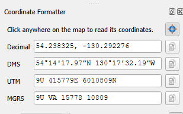

<h1 align="center">
  <br>
  Coordinate Formatter
</h1>

<p align="center">
  Click anywhere on a QGIS map and read the point as <b>decimal degrees, DMS, UTM and MGRS</b>, with one-click copy for each.
</p>

<p align="center">
  <a href="https://github.com/ServitorXur/Location-data-QGIS-Plugin/releases/latest"></a>
  <a href="https://github.com/ServitorXur/Location-data-QGIS-Plugin/actions"></a>
  
  <a href="LICENSE"></a>
</p>

<p align="center"></p>

## Features

- **Four formats at once.** Every click shows all of these:

  | Format  | Example (Big Ben, London)    |
  |---------|------------------------------|
  | Decimal | `51.500729, -0.124625`       |
  | DMS     | `51°30'02.62"N 0°07'28.65"W` |
  | UTM     | `30U 699566E 5709431N`       |
  | MGRS    | `30U XC 99565 09430`         |

- **Copy buttons.** Each format has a button that copies its value to the clipboard.
- **Works in any project CRS.** Points are converted to WGS84 before formatting.
- **Map marker.** A crosshair marks the last point you picked and disappears when you close the panel.
- **Handles the edge cases.** UTM zone exceptions for Norway and Svalbard are applied, and polar points outside UTM's range are labelled as such instead of returning wrong values.
- **No dependencies.** It's pure Python, so there's nothing extra to `pip install`.

## Install

1. Download `coordinate_formatter-vX.Y.Z.zip` from the [latest release](https://github.com/ServitorXur/Location-data-QGIS-Plugin/releases/latest).
2. In QGIS, open **Plugins → Manage and Install Plugins… → Install from ZIP**.
3. Select the zip and click **Install Plugin**.

## Usage

1. Click the **Coordinate Formatter** button on the toolbar, or open it from **Plugins → Coordinate Formatter**.
2. Click any point on the map. The panel fills in all four formats.
3. Click the copy button next to the format you want.

The tool stays active until you pick another map tool, such as Pan. To start picking again, click the button on the toolbar or at the top of the panel.

## Development

To run QGIS against your working copy, link the plugin folder into your QGIS profile:

```sh
# Linux
ln -s "$PWD/coordinate_formatter" ~/.local/share/QGIS/QGIS3/profiles/default/python/plugins/
# macOS
ln -s "$PWD/coordinate_formatter" ~/Library/Application\ Support/QGIS/QGIS3/profiles/default/python/plugins/
```

```powershell
# Windows (PowerShell)
New-Item -ItemType Junction -Path "$env:APPDATA\QGIS\QGIS3\profiles\default\python\plugins\coordinate_formatter" -Target "$PWD\coordinate_formatter"
```

The coordinate math is in [`formats.py`](coordinate_formatter/formats.py) and doesn't import QGIS, so you can test it with plain Python:

```sh
python -m unittest discover -s tests
```

### Releasing

1. Bump `version=` in [`metadata.txt`](coordinate_formatter/metadata.txt).
2. Commit, then tag the commit with the same version and push it:

   ```sh
   git tag v1.0.0 && git push origin v1.0.0
   ```

GitHub Actions runs the tests, builds the zip and publishes a release. The build fails if the tag doesn't match the version in `metadata.txt`.

## License

[GPL-2.0-or-later](LICENSE) © Nathan Mackintosh
